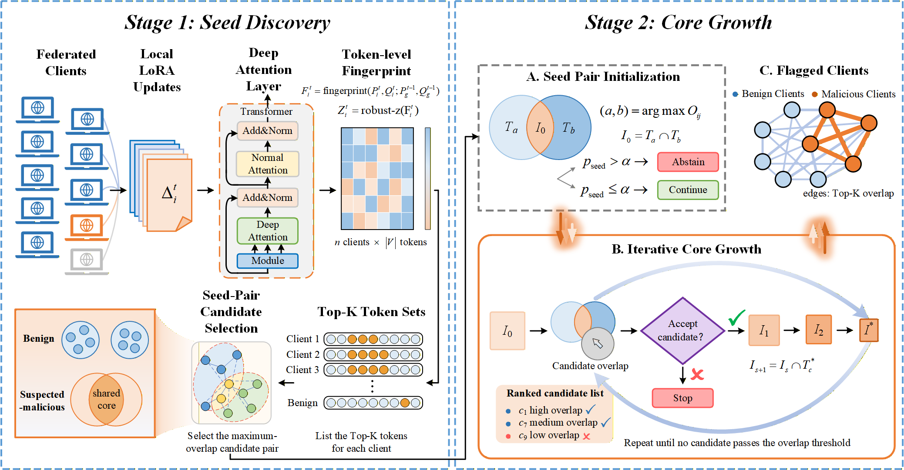

<div align="center">
  <h2 align="center">SCB: Backdoor Detection for Federated LoRA Instruction Tuning via Shared-Core Bicliques on Vocabulary Fingerprints</h2>
</div>

<div align="center">
  
</div>

SCB is a server-side defense for federated LoRA instruction tuning. Each round it projects
every client's low-rank increment through the frozen output path of the backbone onto the
vocabulary, keeps the Top-K tokens of each client as an evidence set, tests whether the most
overlapping pair of clients is statistically significant, and grows the flagged group around
their shrinking common core. It needs no data, no forward inference, and no prior on the
number of malicious clients; FedAvg aggregation is unchanged.

# Setup

```bash
conda create -n scb python=3.10 && conda activate scb
pip install -r requirements.txt
```

Datasets: copy the `QuestionAnswering` folder of
[ProtegoFed](https://github.com/dongdongzhaoUP/ProtegoFed/tree/main/datasets/QuestionAnswering)
(WebQA, FreebaseQA, NQ, CoQA) into `data/QuestionAnswering/`. Our FictBio dataset is included
there: 5000 training questions in 10 contiguous client blocks and 2000 test questions about
200 fictional persons.

# Usage

```bash
# undefended FedAvg, clients 7/8/9 poison 20% of their data with BadNets
python main.py --model <backbone_dir> --dataset webqa --defense none --output_dir runs/webqa_fedavg
# the same run with SCB on the server
python main.py --model <backbone_dir> --dataset webqa --defense scb  --output_dir runs/webqa_scb
# ASR / CACC / KMR on the official test split
python evaluate.py --model <backbone_dir> --dataset webqa --adapter runs/webqa_scb
```

Defaults: 10 clients all participating for 30 rounds, 1 local epoch per round, LoRA r=4 /
alpha=8 on `q_proj,v_proj`, learning rate 1e-4 with round-level linear decay, batch 4,
sequence length 256 (`--seq_length 512` for NQ), contiguous client shards (`--split iid`
for shuffled shards), SCB with K=20, alpha=0.01, readout at the second-deepest layer and a
norm pre-check at 3 robust standard deviations. Per-round decisions are written to
`<output_dir>/scb_detection.json`; `--malicious_ids ""` runs the no-attack control.

# Files

| File | Content |
|---|---|
| `scb.py` | vocabulary fingerprint, seed test and core growth, per-round detector |
| `main.py` | federated training loop with optional SCB |
| `evaluate.py` | attack success rate and clean-task metrics |
| `data_utils.py` | dataset loading, BadNets poisoning, client partition, prompt formatting, metrics |

# Acknowledgement

Built on [OpenFedLLM](https://github.com/rui-ye/OpenFedLLM),
[ProtegoFed](https://github.com/dongdongzhaoUP/ProtegoFed) and
[PEFT](https://github.com/huggingface/peft).
